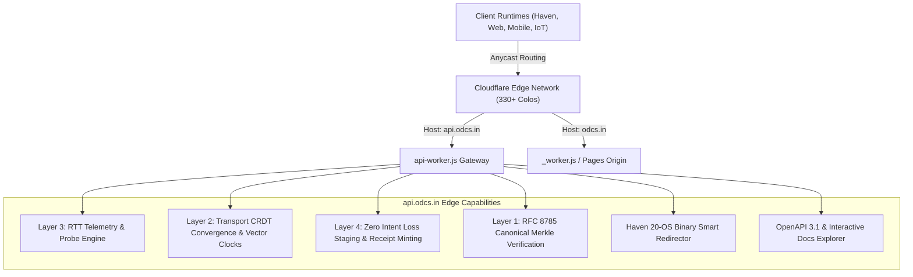

# `api.odcs.in` • Official Edge API Gateway
**Open Digital Continuity Standard (ODCS-1.0.0) Specification**  
*Architecture, Protocols & Specifications Designed by Anirudha Puthraya*

---

## 1. Overview & Architecture

`https://api.odcs.in` is the official institutional API gateway powering the Open Digital Continuity Standard (ODCS) ecosystem and the Haven Programming Language runtime. Running globally across Cloudflare's Anycast network (330+ points of presence), the gateway delivers sub-millisecond edge latency, autonomous partition tolerance, and strict cryptographic continuity.



### Key Architectural Guarantees
1. **Zero Non-Consensual Telemetry:** No user identity tracking, fingerprinting, or behavioral analytics.
2. **RFC 8785 Canonical Serialization:** All cryptographic hashes are computed over canonical deterministic JSON.
3. **Strong Eventual Consistency (SEC):** Distributed state convergence powered by Conflict-Free Replicated Data Types (PN-Counters and Add-Wins Observed-Removed Sets).
4. **Sub-16ms Edge Receipt Minting:** Layer 4 Zero Intent Loss receipts are generated at the edge colo before backhaul propagation.
5. **Universal 20-OS Haven Distribution:** Direct binary release routing with embedded SHA-256 integrity validation headers.

---

## 2. Interactive Discovery & OpenAPI Specification

| Resource | URL | Description |
| :--- | :--- | :--- |
| **Interactive API Explorer** | [`https://api.odcs.in/docs`](https://api.odcs.in/docs) | Real-time interactive visual API documentation with live console |
| **OpenAPI 3.1.0 JSON** | [`https://api.odcs.in/openapi.json`](https://api.odcs.in/openapi.json) | Complete machine-readable OpenAPI specification |
| **RFC 6570 Discovery Root** | [`https://api.odcs.in/`](https://api.odcs.in/) | Hypermedia index of all supported v1 continuity endpoints |
| **RFC 5785 Health Check** | [`https://api.odcs.in/healthz`](https://api.odcs.in/healthz) | Edge node health, latency, and status probe |

---

## 3. Endpoints Catalog & Specifications

All endpoints are accessible via both the versioned prefix `/v1/...` and top-level root `/...`.

### Layer 3: Network Telemetry & RTT Probing
Measures network round-trip time and edge colo latency to determine the active ODCS continuity mode (`OPTIMAL_ONLINE`, `DEGRADED_JITTER`, `SEVERED_OFFLINE`).

- **Endpoint:** `GET /v1/telemetry/probe` (or `HEAD /v1/telemetry/probe?zero=1`)
- **Headers Returned:**
  - `X-ODCS-Standard: ODCS-1.0.0`
  - `X-ODCS-Edge-Colo: <COLO_CODE>` (e.g. `BOM`, `SIN`, `DFW`, `LHR`)
  - `X-ODCS-Continuity-Mode: OPTIMAL_ONLINE`
  - `X-Server-Timing: edge;dur=<MS>`
- **Response (200 OK):**
```json
{
  "status": "ONLINE",
  "standard": "ODCS-1.0.0",
  "author": "Anirudha Puthraya",
  "specification": "ODCS-SPEC-004 Layer 3 (Runtime Adaptation)",
  "edge": {
    "colo": "BOM",
    "country": "IN",
    "city": "Mumbai",
    "asn": 13335,
    "httpProtocol": "HTTP/3",
    "edgeTime": "2026-11-01T11:30:00.000Z",
    "edgeTimestampMs": 1793529000000
  },
  "telemetry": {
    "mode": "OPTIMAL_ONLINE",
    "mode_code": 1,
    "mode_label": "Optimal Online (< 120ms)",
    "packet_loss_ratio": 0.0,
    "compression": "br, zstd, gzip",
    "retry_strategy": "Full-Jitter Exponential Backoff"
  }
}
```

---

### Layer 2: Transport CRDT Consensus & Outbox Sync
Receives batch mutation deltas and distributed data structures, merging them via Strong Eventual Consistency.

- **Endpoint:** `POST /v1/sync`
- **Payload:**
```json
{
  "node_id": "field-agent-01",
  "clock": { "field-agent-01": 5 },
  "counters": {
    "network_transactions": { "p": { "field-agent-01": 20 }, "n": {} }
  },
  "sets": {
    "active_nodes": { "add_set": { "field-agent-01": ["tag-001"] }, "remove_set": [] }
  },
  "mutations": [
    { "mutation_id": "tx-1001", "intent": "RecordSensorData", "val": 42 }
  ]
}
```
- **Response (200 OK):**
```json
{
  "standard": "ODCS-1.0.0",
  "status": "CONVERGED",
  "protocol": "ODCS-SPEC-003 Layer 2 (CRDT Delta Convergence)",
  "edge_colo": "BOM",
  "edge_vector_clock": {
    "cf-edge-global": 2,
    "field-agent-01": 5
  },
  "converged_counters": {
    "network_transactions": 120
  },
  "converged_sets": {
    "active_nodes": ["node-central-cloud", "node-edge-ambulance", "field-agent-01"]
  },
  "acknowledged_mutations": ["tx-1001"],
  "receipt_hash": "a591a6d40bf420404a011733cfb7b190d62c65bf0bcda32b57b277d9ad9f146e",
  "sync_timestamp": 1793529000000
}
```

---

### Layer 4: Zero Intent Loss Staging & Receipt Minting
Ensures human inputs and transactions are permanently staged with an immutable cryptographic receipt before forwarding to origin systems.

- **Endpoint:** `POST /v1/intent/preserve`
- **Payload:**
```json
{
  "user": "Dr. Sarah",
  "action": "TriagePrescription",
  "payload": { "patient": "P-882", "med": "Atropine", "dose": "0.5mg" }
}
```
- **Response (201 Created):**
```json
{
  "standard": "ODCS-1.0.0",
  "invariant": "Zero Intent Loss (ZIL)",
  "status": "PRESERVED_AT_EDGE",
  "receipt_id": "zil_b4d8c7e91234abcd",
  "staged_proof": "e3b0c44298fc1c149afbf4c8996fb92427ae41e4649b934ca495991b7852b855",
  "edge_colo": "BOM",
  "minted_at": "2026-11-01T11:30:00.000Z",
  "minted_timestamp": 1793529000000,
  "guarantee": "Under ODCS-1.0.0 Invariant 1, this operation has been committed to edge memory and cannot be lost."
}
```

---

### Layer 1: Merkle Integrity & Genesis Block
Validates payloads against RFC 8785 Canonical JSON digests or retrieves the immutable Genesis anchor.

- **Verify Payload:** `POST /v1/verify`
  - Body: `{"payload": {...}, "expected_digest": "..."}`
  - Returns: `{"verified": true, "calculated_digest": "..."}`
- **Genesis Block:** `GET /v1/ledger/genesis`
  - Returns the root genesis block with SHA-256 anchor and architecture metadata.

---

### Haven Language 20-OS Release Binary Router
Provides automated redirection to native compiled release packages for all 20 supported operating systems.

- **Downloads Catalog:** `GET /v1/downloads` (Returns JSON manifest of all 20 packages with SHA-256 checksums)
- **Smart Download Router:** `GET /v1/downloads/{platform}`
  - Supported platforms: `windows`, `portable`, `cli`, `win-arm64`, `linux`, `deb`, `deb-arm64`, `rpm`, `appimage`, `arch`, `alpine`, `tarball`, `macos`, `macos-arm64`, `bsd`, `freebsd`, `android`, `rpi`, `wasm`, `latest`
  - When querying `GET /v1/downloads/latest`, the edge worker inspects the client's `User-Agent` and issues an automated HTTP 302 redirect with checksum headers:
    - `Location: https://odcs.in/heaven/downloads/Haven-1.0.0-win64-Setup.exe`
    - `X-Haven-Package: Haven Windows Setup Installer (x64)`
    - `X-Haven-SHA256: b325da0b205aa833772274b7c6cb8469ad51b54a8616c683b51680d22f2a32e6`

---

### Schemas Catalog
- **Catalog Index:** `GET /v1/schemas`
- **Specific Schema:** `GET /v1/schemas/mutation_envelope` or `GET /v1/schemas/intent_receipt`

---

## 4. Code Examples

### cURL
```bash
# 1. RTT Telemetry Probe
curl -i https://api.odcs.in/v1/telemetry/probe

# 2. Stage Mutation with Zero Intent Loss
curl -X POST https://api.odcs.in/v1/intent/preserve \
  -H "Content-Type: application/json" \
  -d '{"user":"Lead Architect","action":"DeployEdge","payload":{"colo":"BOM"}}'

# 3. Download Haven CLI for current platform
curl -LO https://api.odcs.in/v1/downloads/cli
```

---

### Haven Language (`haven`)
```haven
import urllib.request
import json

# Query Layer 3 Network Telemetry
req = urllib.request.Request("https://api.odcs.in/v1/telemetry/probe")
with urllib.request.urlopen(req) as response:
    telemetry = json.loads(response.read().decode())
    print(f"Connected to Cloudflare Edge Colo: {telemetry['edge']['colo']}")
    print(f"Continuity Mode: {telemetry['telemetry']['mode']}")

# Mint Zero Intent Loss Receipt
intent_data = json.dumps({
    "user": "HavenRuntime",
    "action": "LedgerSync",
    "payload": {"records": 5}
}).encode()

stage_req = urllib.request.Request(
    "https://api.odcs.in/v1/intent/preserve",
    data=intent_data,
    headers={"Content-Type": "application/json"}
)
with urllib.request.urlopen(stage_req) as res:
    receipt = json.loads(res.read().decode())
    print(f"Minted Receipt ID: {receipt['receipt_id']}")
```

---

### JavaScript / TypeScript
```typescript
// Telemetry Probe
const res = await fetch("https://api.odcs.in/v1/telemetry/probe");
const data = await res.json();
console.log(`Edge Colo: ${data.edge.colo}, Protocol: ${data.edge.httpProtocol}`);

// Transport CRDT Delta Convergence
const syncRes = await fetch("https://api.odcs.in/v1/sync", {
  method: "POST",
  headers: { "Content-Type": "application/json" },
  body: JSON.stringify({
    clock: { "web-client": 1 },
    counters: { "network_transactions": { p: { "web-client": 1 }, n: {} } }
  })
});
const syncData = await syncRes.json();
console.log("Converged Counters:", syncData.converged_counters);
```

---

## 5. Deployment Guide on Cloudflare

### Method 1: Unified Cloudflare Pages Deployment (Recommended)
`_worker.js` automatically inspects `url.hostname`. By routing both `odcs.in` and `api.odcs.in` to your Cloudflare Pages project, a single unified deployment handles both:
1. In Cloudflare Dashboard -> **Workers & Pages** -> your project -> **Custom Domains**.
2. Add `odcs.in` and `api.odcs.in`.
3. Requests to `api.odcs.in` are instantly delegated to `api-worker.js`.

### Method 2: Dedicated Cloudflare Worker
Deploy `api-worker.js` as an isolated high-performance worker:
```bash
# In "E:\ODCS models"
wrangler deploy -c wrangler.api.toml
```

---

**Lead Architect:** Anirudha Puthraya  
**Standard:** Open Digital Continuity Standard (ODCS-1.0.0)  
**Gateway Subdomain:** `api.odcs.in`

