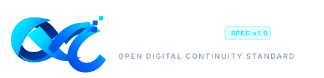

<div align="center">



# Open Digital Continuity Standard (ODCS)
### *Digital experiences that endure without the network.*

[](LICENSE)
[](SPECIFICATION.md)
[](https://t.me/opendigitalcontinuity)
[](https://github.com/Veyra-Programming/odc-model-algorithm)
[](https://github.com/Veyra-Programming/star-language)
[](https://github.com/Veyra-Programming/haven-Language-)
[](https://github.com/Veyra-Programming/star-haven)
[](https://github.com/Veyra-Programming/odcs-website)
[](RELEASE_NOTES.md)
[](https://odcs.in)
[](docs/ARCHITECTURE.md)

[Official Website (odcs.in)](https://odcs.in) • [Telegram Community](https://t.me/opendigitalcontinuity) • [ODC Model & ODA Algorithm](https://github.com/Veyra-Programming/odc-model-algorithm) • [Star Language Repo](https://github.com/Veyra-Programming/star-language) • [Haven Language Repo](https://github.com/Veyra-Programming/haven-Language-) • [Dual-Engine Repo](https://github.com/Veyra-Programming/star-haven) • [Website Repo](https://github.com/Veyra-Programming/odcs-website) • [Release Notes](RELEASE_NOTES.md) • [Full Star & Haven Reference](docs/STAR_HAVEN_FULL_REFERENCE.md) • [Specification](SPECIFICATION.md)

</div>

---

## 📢 Milestone 1 Complete: The Sovereign Dual-Engine Era

The **Open Digital Continuity Standard (ODCS-2.0.0 GA)** has officially completed **Milestone 1**, introducing the production **Dual-Engine Sovereign Architecture** across both frontend client runtimes and distributed continuity backends:

- **⭐ Star Programming Language (v1.2.0 GA)**: Universal, zero-virtual-DOM declarative UI engine compiling directly to a **4.9 KB WebAssembly core (`app.wasm`)**. Guarantees single-frame 60 FPS reactive updates ($\Delta t \le 16.66\text{ms}$) with zero npm dependencies.
- **🕊️ Haven (Heaven) Language (v2.0)**: Natural-English grammar continuity engine. Features immutable cryptographic records (`durable record`), append-only Merkle Write-Ahead Logs (WAL), sub-16ms local authority receipts, and conflict-free replicated data types (CRDTs).
- **🌌 Unified Dual-Engine Repository**: Fully integrated at [github.com/Veyra-Programming/star-haven](https://github.com/Veyra-Programming/star-haven).
- **📦 Sovereign Package Managers Announced**: Official notice that `star pkg` and `haven pkg` with `star.toml` / `haven.toml` manifests and RFC 8785 lockfiles are entering Phase 2 implementation. Read the [Complete Dual-Engine Specification & 235 Standard Modules Guide](docs/STAR_HAVEN_FULL_REFERENCE.md).

---

## 🌐 The ODCS Mission: Ending the "Always-Online" Fallacy

Modern software applications are overwhelmingly architected under a fundamentally flawed assumption: **that network connectivity is permanent, instantaneous, and uninterrupted**.

When connectivity drops, client-server applications collapse:
- Spinning wheels lock the user interface.
- Mission-critical form inputs and transactions are irreversibly wiped.
- Centralized cloud servers reject out-of-order mutations.
- Critical operations in hospitals, disaster response, and logistics halt.

The **Open Digital Continuity Standard (ODCS)** is a sovereign, vendor-neutral architectural standard establishing protocols, invariants, and language specifications for systems that guarantee **Zero Intent Loss (ZIL)** across all network conditions—from gigabit fiber to high-latency satellite, intermittent cellular, and total offline blackouts.

---

## 🏛️ The Four-Layer ODC Architecture

ODCS organizes digital continuity into a rigorous, four-layer systems hierarchy:

```
┌────────────────────────────────────────────────────────────────────────┐
│  LAYER 4: Application & Continuity UX (Human-Machine Interface)        │
│  - Optimistic single-frame (<16.6ms) UI state mutations                │
│  - Sub-16ms Zero Intent Loss (ZIL) cryptographic receipt minting       │
│  - Ambient continuity status indicators [Synced | Buffered | Syncing]  │
│  - Powered by ⭐ Star Programming Language (v1.2.0 GA / app.wasm)      │
├────────────────────────────────────────────────────────────────────────┤
│  LAYER 3: Runtime & Environmental Adaptation (Operational Context)     │
│  - Real-time active/passive network telemetry & throughput probing     │
│  - Adaptive degradation policies (Optimal, Degraded Jitter, Severed)   │
│  - Monotonic vector clocks and exponential jitter backoff              │
├────────────────────────────────────────────────────────────────────────┤
│  LAYER 2: Transport, Synchronization & Consensus (Distributed Bridge)  │
│  - Conflict-Free Replicated Data Types (CRDTs: PN-Counter, OR-Set)     │
│  - Dual Wire Protocol: ODCS-REL (Ordered) + ODCS-DGM (0-RTT Datagram)  │
│  - Semi-lattice join operations ($V_{merged} = V_{local} \sqcup V_{remote}$) │
│  - Multi-transport failover (HTTPS ↔ WebSocket ↔ WebRTC P2P ↔ BLE)   │
├────────────────────────────────────────────────────────────────────────┤
│  LAYER 1: Local Durability & Cryptographic Storage (Durability Anchor) │
│  - Non-volatile local authority of record (NVMe / IndexedDB / WAL)     │
│  - RFC 8785 Canonical JSON deterministic serialization                 │
│  - Monotonic mutation logging (UUIDv7) with SHA-256 Merkle DAG chains  │
│  - Powered by 🕊️ Haven Language (v2.0 / odcs_backend.hvn)              │
└────────────────────────────────────────────────────────────────────────┘
```

---

## ⚡ Mathematical Invariants of ODCS-2.0.0

### 1. The Zero Intent Loss (ZIL) Single-Frame Guarantee
Local state mutations MUST commit and emit a verifiable cryptographic receipt within a single display refresh cycle:

$$\Delta t_{\text{commit}} \le 16.66\text{ms} \quad (60\text{Hz Frame Budget})$$

Receipts contain an RFC 8785 canonical hash of the action payload sealed with a monotonically increasing UUIDv7 timestamp:

$$\mathcal{H}_{\text{ZIL}} = \text{SHA-256}\Big(\text{RFC8785}\big(\text{action}, \text{payload}, \text{timestamp}_{\text{uuid7}}\big)\Big)$$

### 2. Commutative CRDT Convergence
State operations across partitioned nodes commute algebraically without requiring cloud consensus:

$$S_A \bullet S_B = S_B \bullet S_A$$

$$S_{\text{converged}} = S_A \sqcup S_B$$

---

## 📂 Repository Ecosystem & Architecture

```
open-digital-continuity-standard-/
├── SPECIFICATION.md          # Formal ODCS-2.0.0 GA Specification
├── RELEASE_NOTES.md          # Comprehensive Milestone 1 Release Documentation
├── ROADMAP.md                # 2026–2028 Standards & Deployment Program
├── SCOPE.md                  # Detailed Boundary & Invariant Definitions
├── TERMINOLOGY.md            # Normative RFC-style Glossary
├── GOVERNANCE.md             # Standards Working Group Governance
│
├── docs/                     # Authoritative Documentary Center
│   ├── ARCHITECTURE.md       # Deep Systems Topology & Data Lifecycle
│   ├── IMPLEMENTATION-GUIDE.md# Production Implementation Recipes
│   ├── BRAND-IDENTITY.md     # Official Typography, Logos & Colorway
│   └── FAQ.md                # Frequently Asked Technical Questions
│
├── model/                    # Normative Layer Specifications
│   ├── ODC-MODEL.md          # Master 4-Layer Specification
│   ├── layer-1.md            # Layer 1: Local Durability & Merkle WAL
│   ├── layer-2.md            # Layer 2: Mesh Consensus & CRDT Wire
│   ├── layer-3.md            # Layer 3: Telemetry & Jitter Backoff
│   └── layer-4.md            # Layer 4: UX & Zero Intent Loss
│
├── examples/                 # Reference Client & Implementation Demos
│   └── vanilla-odcs-client/  # Zero-dependency reference client
│
└── heaven/                   # Reference Haven Continuity Gateway
    ├── haven_lang.py         # Natural-English VM & Transpiler
    └── odcs_backend.hvn      # Sovereign Continuity Backend
```

---

## 💻 Dual-Engine Code Showcases

### ⭐ Star Declarative UI (Frontend WASM Core)
```star
# Pure Star Declarative UI (main.star)
use UI
use Material

app ODCSContinuityPortal
    variable current_mode = "OPTIMAL_ONLINE"
    variable staged_receipts = 142

    AppBar(title = "🏛️ ODCS Foundation", elevation = 0)

    Column(padding = 16)
        Card(elevation = 2)
            Text("Mode: " + current_mode, style = TextStyle(color = "#00f0ff"))
            Text("Active Receipts: " + staged_receipts)
        end

        Button("▶ Mint Layer 4 ZIL Receipt (<16ms)", onClick = function()
            staged_receipts = staged_receipts + 1
            show "Minted Zero Intent Loss Cryptographic Receipt"
        end)
    end
end
```

### 🕊️ Haven Natural-English Grammar (Backend Continuity)
```haven
// Sovereign Continuity Backend (odcs_backend.hvn)

durable record EmergencyEncounter:
    patient_id: String
    heart_rate: Integer
    oxygen_saturation: Float

set hospital_ledger to ContinuityLedger.open("haven://genesis-wal")
set encounter to EmergencyEncounter("PT-901", 78, 98.4)

checkpoint encounter as "triage_vital" into hospital_ledger
set receipt to ZeroIntentLoss.preserve("RECORD_VITALS", encounter, "Dr. Sarah")

say "Sealed encounter into Merkle DAG with ZIL Receipt: {receipt['intent_id']}!"
```

---

## ⚡ 1-Click Universal Toolchain Installation

### Windows PowerShell:
```powershell
irm https://odcs.in/install.ps1 | iex
```

### Linux / Ubuntu:
```bash
curl -fsSL https://odcs.in/install.sh | bash
```

### Python SDK (`odcs-sdk`):
```bash
pip install odcs-sdk
```

---

## 📜 Standards Track & Normative RFC Index

| RFC Document | Title & Focus | Status |
| :--- | :--- | :--- |
| **ODCS-RFC-101** | Zero Intent Loss (ZIL) & Single-Frame Authority ($\Delta t \le 16.66\text{ms}$) | **RATIFIED GA** |
| **ODCS-RFC-102** | Append-Only Merkle DAG & Durable Write-Ahead Log (WAL) | **RATIFIED GA** |
| **ODCS-RFC-103** | Asynchronous CRDT Semi-Lattice Convergence & Vector Clocks | **RATIFIED GA** |
| **ODCS-RFC-104** | Sovereign Star WASM Runtime & Frame Budget Guarantees | **RATIFIED GA** |
| **ODCS-RFC-105** | Haven Natural-English Grammar & Immutability Rules | **RATIFIED GA** |

---

## 👨‍💻 Standards Leadership & Creator Attribution

The **Open Digital Continuity Standard (ODCS)**, **Star Programming Language**, and **Haven Language** were architected, designed, and are actively maintained by:

**Anirudha Puthraya**  
*Standards Director & Author · ODCS Standards Foundation*  
*Organization:* [Veyra-Programming](https://github.com/Veyra-Programming)  
*Dual-Engine Repository:* [github.com/Veyra-Programming/star-haven](https://github.com/Veyra-Programming/star-haven)  
*Official Portal:* [https://odcs.in/](https://odcs.in/)  
*GitHub:* [@Anirudha2006-art](https://github.com/Anirudha2006-art)  

---

## ⚖️ License & Open Standard Grant

Licensed under the **Apache License, Version 2.0**.  
See [LICENSE](LICENSE) for full legal text.  
Copyright © 2026 ODCS Standards Foundation and Veyra-Programming. All Rights Reserved.
