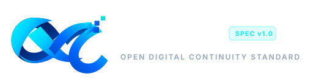

<div align="center">



# Open Digital Continuity Standard (ODCS)
### *Digital experiences that endure without the network.*

[](LICENSE)
[](model/ODC-MODEL.md)
[](https://odcs.in)
[](docs/ARCHITECTURE.md)
[](CONTRIBUTING.md)

[Official Website](https://odcs.in) • [Specification Draft](model/ODC-MODEL.md) • [Architecture Guide](docs/ARCHITECTURE.md) • [Reference Client](examples/vanilla-odcs-client/) • [Contributing](CONTRIBUTING.md)

</div>

---

## 🌐 The ODCS Mission

Modern software applications are overwhelmingly built on a fragile assumption: that network connectivity is permanent, instantaneous, and uninterrupted. When networks degrade or vanish, user experiences collapse: data is lost, spinners freeze, operations fail, and productivity halts.

The **Open Digital Continuity Standard (ODCS)** is a global, vendor-neutral initiative establishing the architectural standards, protocols, and interface specifications for software systems that maintain deterministic operational continuity across all network conditions—from gigabit fiber to high-latency satellite, intermittent cellular, and prolonged offline blackouts.

---

## 🏛️ The Four-Layer ODC Model

ODCS establishes digital continuity as a multi-tier systems discipline organized into four standardized layers:

```
┌────────────────────────────────────────────────────────────────────────┐
│  LAYER 4: Application & Continuity UX (Human-Machine Interface)        │
│  - Optimistic view mutations & instantaneous (<16ms) DOM feedback     │
│  - Ambient continuity status indicators [Synced | Buffered | Syncing]  │
│  - Form intent auto-preservation & side-by-side conflict diffing       │
├────────────────────────────────────────────────────────────────────────┤
│  LAYER 3: Runtime & Environmental Adaptation (Operational Context)     │
│  - Real-time active/passive network telemetry & throughput probing     │
│  - Standardized degradation modes (Optimal, Constrained, High-Latency) │
│  - Hardware-aware throttling (battery, CPU, storage pressure)          │
├────────────────────────────────────────────────────────────────────────┤
│  LAYER 2: Transport, Synchronization & Consensus (Distributed Bridge)  │
│  - Store-and-forward outbox pipelines with exponential backoff & jitter│
│  - Conflict-Free Replicated Data Types (CRDTs) & Vector Clocks         │
│  - Multi-transport failover (HTTPS ↔ WebSockets ↔ WebRTC P2P ↔ BLE)   │
├────────────────────────────────────────────────────────────────────────┤
│  LAYER 1: Local Durability & Cryptographic Storage (Durability Anchor) │
│  - Non-volatile local authority of record (IndexedDB / SQLite / WAL)   │
│  - Monotonic mutation logging (UUIDv7) with Merkle DAG hash chaining   │
│  - Storage quota governance & zero-data-loss crash recovery            │
└────────────────────────────────────────────────────────────────────────┘
```

| Layer | Focus | Key Specifications |
| :--- | :--- | :--- |
| **Layer 4** | Human Experience & Zero-Loss Input | [Layer 4 Specification](model/layer-4.md) |
| **Layer 3** | Environmental Sensing & Adaptive Policies | [Layer 3 Specification](model/layer-3.md) |
| **Layer 2** | Distributed Sync, CRDTs & Outbox Pipelines | [Layer 2 Specification](model/layer-2.md) |
| **Layer 1** | Persistent Durability & Write-Ahead Logs | [Layer 1 Specification](model/layer-1.md) |

---

## ⚡ Quick Start: Running the Reference Client

ODCS includes a zero-dependency reference implementation demonstrating all four layers in action:

```bash
# Clone the repository
git clone https://github.com/Veyra-Programming/open-digital-continuity-standard-.git
cd open-digital-continuity-standard-

# Serve locally using any static web server
npx serve .
# Or Python
python -m http.server 8000
```

Open `http://localhost:8000` to interact with the **ODCS Institutional Portal & Live Continuity Simulator**.

---

## 📚 Specification & Technical Documentation

* 📜 **[ODC-MODEL.md](model/ODC-MODEL.md):** Complete formal core specification with RFC-2119 conformance criteria.
* 🏗️ **[ARCHITECTURE.md](docs/ARCHITECTURE.md):** End-to-end distributed system topology and data flow lifecycles.
* 💻 **[IMPLEMENTATION-GUIDE.md](docs/IMPLEMENTATION-GUIDE.md):** Production-ready code recipes in TypeScript, JavaScript, and React.
* 🎨 **[BRAND-IDENTITY.md](docs/BRAND-IDENTITY.md):** Official ODCS logo identity, color palette, symbolism, and vector assets.
* ❓ **[FAQ.md](docs/FAQ.md):** In-depth answers regarding PWAs, Local-First, CRDTs, and security.

---

## 🎓 Academic & Institutional Citation

If you are citing the Open Digital Continuity Standard in academic research, technical whitepapers, or curriculum, please use the following BibTeX entry:

```bibtex
@techreport{odcs2026spec,
  title       = {{Open Digital Continuity Standard (ODCS): A Four-Layer Architectural Model for Disruption-Tolerant Distributed Systems}},
  author      = {{ODCS Working Group}},
  institution = {{Open Digital Continuity Initiative}},
  year        = {2026},
  month       = {October},
  type        = {Standard Specification Draft},
  number      = {ODCS-SPEC-001},
  url         = {https://odcs.in/spec/v1.0/}
}
```

---

## 🤝 Contributing & Community Governance

ODCS is maintained as a transparent, open-standard initiative under the **Apache 2.0 License**. We actively welcome contributions from developers, university researchers, civil infrastructure engineers, and open-source contributors:

1. Read our **[Contribution Guidelines](CONTRIBUTING.md)** for our RFC proposal process.
2. Abide by our **[Code of Conduct](CODE_OF_CONDUCT.md)**.
3. Review our **[Evolution Roadmap](ROADMAP.md)** to see upcoming milestone targets.
4. Report vulnerabilities securely via our **[Security Policy](SECURITY.md)**.

---

<div align="center">
<sub>Maintained with pride by the Open Digital Continuity Standard Working Group.<br/>
Licensed under the Apache License, Version 2.0.</sub>
</div>
